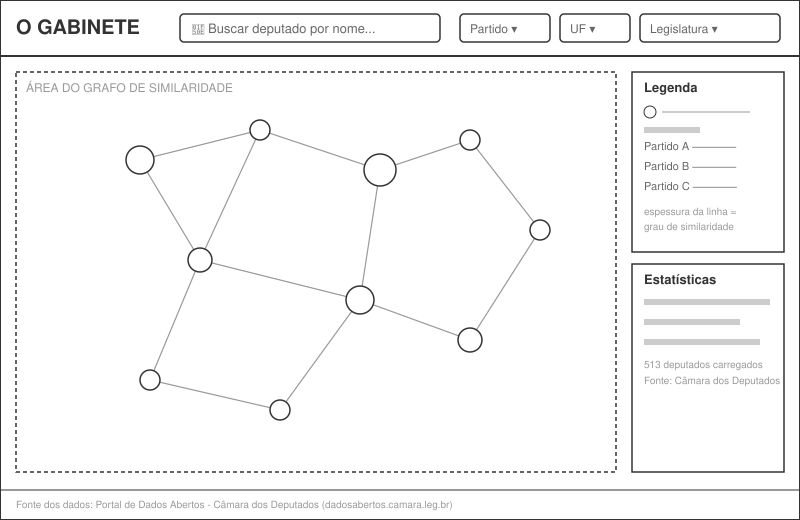
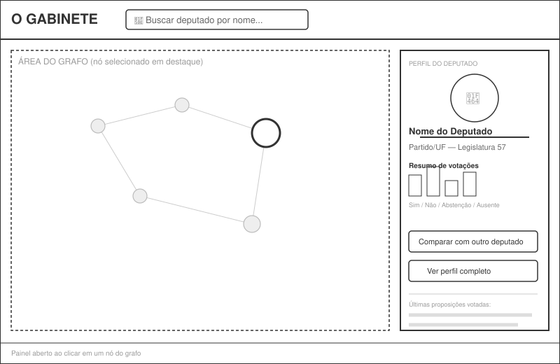
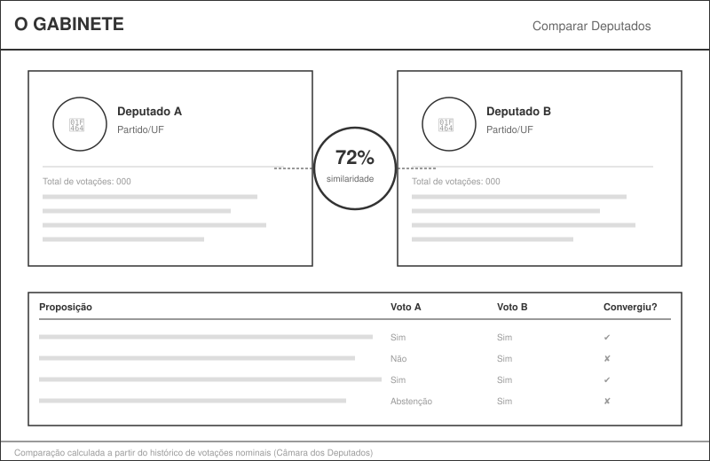
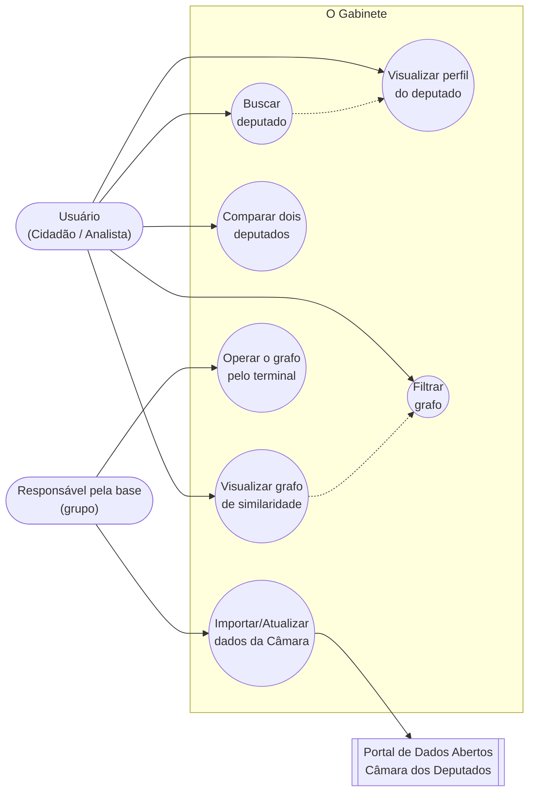
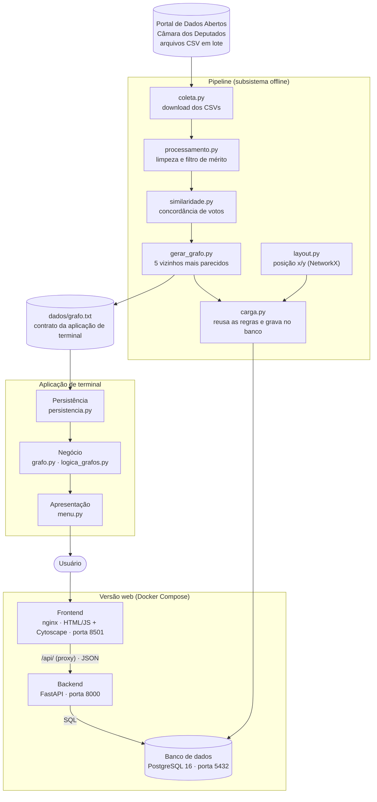

# O Gabinete — Mapa de Similaridade Política entre Deputados Federais

> **TG1 – Definição do Produto de Software**
> Laboratório de Engenharia de Software — Universidade Presbiteriana Mackenzie

[](https://github.com/hissapinto/o-gabinete/actions/workflows/testes-api.yml)
[](https://github.com/hissapinto/o-gabinete/actions/workflows/testes-terminal.yml)

**Protótipo no ar:** <https://hissapinto.github.io/o-gabinete/web/prototipo/>

---

## Capa

| | |
|---|---|
| **Universidade** | Universidade Presbiteriana Mackenzie — Faculdade de Computação e Informática |
| **Disciplinas** | Laboratório de Engenharia de Software (Turma 6º D) · Teoria dos Grafos (Turma 6º D) · Interação Humano-Computador (Turma 6º D) |
| **Professores** | Gustavo Moreira Calixto (Lab. de Engenharia de Software) · Ivan Carlos Alcântara de Oliveira (Teoria dos Grafos) · Profa. Elisângela Botelho Gracias (Interção Humano Computador) |
| **Projeto** | O Gabinete — Mapa de Similaridade Política entre Deputados Federais |
| **Grupo** | Caio Ariel Cardoso Saraiva (RA 10439611) · Isabela Hissa Pinto (RA 10441873) · Kaique Barros Paiva (RA 10441787) · Mateus Kage Moya (RA 10332608) |
| **Repositório** | [github.com/hissapinto/o-gabinete](https://github.com/hissapinto/o-gabinete) |
| **Entrega** | TG1 |

> **Composição por disciplina.** O enunciado de Teoria dos Grafos limita os grupos a três integrantes. Naquela disciplina o projeto é entregue por Caio Ariel Cardoso Saraiva, Isabela Hissa Pinto e Kaique Barros Paiva. No Laboratório de Engenharia de Software o grupo conta também com Mateus Kage Moya.

---

## Sumário

1. [Introdução](#capítulo-1--introdução)
2. [Definição da Demanda](#capítulo-2--definição-da-demanda)
   - 2.1 [O problema ou oportunidade percebida](#21-o-problema-ou-oportunidade-percebida)
   - 2.2 [A razão ou justificativa para esta demanda](#22-a-razão-ou-justificativa-para-esta-demanda)
   - 2.3 [Descrição sucinta do produto de software](#23-descrição-sucinta-do-produto-de-software)
   - 2.4 [Clientes, usuários e demais envolvidos](#24-clientes-usuários-e-demais-envolvidosimpactados)
   - 2.5 [Principais etapas para construir o produto](#25-principais-etapas-necessárias-para-construir-o-produto)
   - 2.6 [Principais critérios de qualidade](#26-principais-critérios-de-qualidade-para-o-produto)
3. [Requisitos](#capítulo-3--requisitos)
4. [Wireframes](#capítulo-4--wireframes)
5. [Modelagem Leve do Sistema (Casos de Uso)](#capítulo-5--modelagem-leve-do-sistema-casos-de-uso)
6. [Arquitetura do Sistema](#capítulo-6--arquitetura-do-sistema)

> **Nota de escopo:** o projeto foi originalmente proposto na disciplina de Teoria dos Grafos ("Mapa de Similaridade Política") e é aqui detalhado como produto de software do Laboratório de Engenharia de Software. A fonte de dados foi restringida **exclusivamente à Câmara dos Deputados** (não ao Senado Federal), consumindo o [Portal de Dados Abertos da Câmara](https://dadosabertos.camara.leg.br/swagger/api.html). Este documento é incremental e será expandido nas próximas entregas (TG2, TG3...).

---

## Capítulo 1 – Introdução

O presente documento constitui a primeira entrega (TG1) do grupo na disciplina de Laboratório de Engenharia de Software, cujo objetivo é definir, de forma inicial, o produto de software a ser desenvolvido ao longo do semestre.

O produto, batizado de **"O Gabinete"**, é uma aplicação que constrói e visualiza um **grafo de similaridade entre deputados federais brasileiros**, a partir de dados públicos de votações nominais disponibilizados pela Câmara dos Deputados. A proposta nasceu na disciplina de Teoria dos Grafos e é aqui detalhada sob a ótica da Engenharia de Software: levantamento de requisitos, casos de uso, protótipo de interface (wireframe) e arquitetura da solução.

Os capítulos seguintes serão incrementados a cada nova entrega do grupo, conforme o andamento do projeto.

---

## Capítulo 2 – Definição da Demanda

### 2.1 O problema ou oportunidade percebida

A Câmara dos Deputados disponibiliza um grande volume de dados públicos sobre a atuação de seus parlamentares — votações nominais, proposições, filiação partidária, entre outros — por meio do seu Portal de Dados Abertos. Entretanto, esses dados são disponibilizados de forma fragmentada (arquivos CSV separados por ano, endpoints distintos da API REST) e pouco intuitiva, o que dificulta que um cidadão comum identifique padrões de comportamento e similaridade entre diferentes deputados sem conhecimento técnico prévio.

### 2.2 A razão ou justificativa para esta demanda

Grafos são uma representação natural para esse problema: cada deputado pode ser modelado como um vértice, e o grau de similaridade de comportamento de voto entre dois deputados como uma aresta ponderada. O partido não entra no cálculo da similaridade — ele é representado visualmente pela cor do vértice, de modo que os deputados que votam fora da orientação da própria bancada apareçam deslocados no grafo, o que é justamente o padrão mais informativo.

Visualizar esse grafo permite identificar de forma intuitiva agrupamentos (blocos de votação, alianças informais, votos cruzados) que seriam difíceis de perceber apenas analisando planilhas. Isso está alinhado ao **ODS 16 (Paz, Justiça e Instituições Eficazes)**, ao promover maior acesso à informação e transparência sobre a atuação política.

### 2.3 Descrição sucinta do produto de software

"O Gabinete" é uma aplicação desenvolvida em Python que:

- importa periodicamente dados de deputados e de votações nominais da Câmara dos Deputados;
- calcula um índice de similaridade de comportamento de voto entre cada par de deputados;
- constrói um grafo não orientado ponderado (deputados = vértices, similaridade = arestas), persistido no arquivo `dados/grafo.txt`;
- oferece uma aplicação de terminal com menu de operações sobre o grafo (leitura, gravação, inserção, remoção, exibição e análise de conexidade);
- oferece, adicionalmente, uma interface web interativa para visualizar, buscar, filtrar e comparar deputados a partir desse grafo.

### 2.4 Clientes, usuários e demais envolvidos/impactados

| Papel | Descrição |
|---|---|
| **Cliente** | O grupo do projeto/disciplina, representando, de forma simulada, uma organização de fomento à transparência política (ex.: ONG de dados abertos, veículo de imprensa) interessada em disponibilizar a ferramenta ao público. |
| **Usuários** | Cidadãos interessados em política, jornalistas, pesquisadores, estudantes de ciências políticas e analistas de dados. |
| **Envolvidos indiretos (impactados)** | Deputados federais, cujos dados públicos de atuação parlamentar são exibidos e comparados pela ferramenta. |
| **Ator de suporte** | Portal de Dados Abertos da Câmara dos Deputados, fonte de todos os dados consumidos pelo sistema. |

### 2.5 Principais etapas necessárias para construir o produto

1. Levantamento e especificação de requisitos (este documento).
2. Prototipação de baixa fidelidade da interface (wireframes).
3. Investigação exploratória da fonte de dados (*spike*), para verificar o volume de votações nominais disponíveis antes de fixar a modelagem.
4. Construção do pipeline de ingestão (download e tratamento dos arquivos e endpoints da Câmara).
5. Implementação do motor de cálculo de similaridade e do gerador do arquivo `grafo.txt`.
6. Implementação da estrutura de grafo e dos algoritmos de análise.
7. Implementação da aplicação de terminal com o menu de operações.
8. Implementação da interface web de visualização, busca, filtro e comparação.
9. Testes com dados reais e validação com o grupo e com os professores.
10. Ajustes de desempenho e usabilidade a partir do feedback recebido.

### 2.6 Principais critérios de qualidade para o produto

Utilizando a categorização **FURPS+** como referência:

- **Usabilidade:** a interface deve ser compreensível por um usuário sem conhecimento técnico em grafos ou ciência de dados.
- **Desempenho:** a renderização do grafo e a aplicação de filtros devem ocorrer em tempo aceitável (poucos segundos), mesmo com centenas de deputados carregados.
- **Confiabilidade:** o sistema deve lidar com indisponibilidades temporárias do Portal de Dados Abertos sem perder os dados já importados anteriormente. O grafo é versionado no repositório, de modo que a aplicação permanece executável mesmo sem acesso à fonte.
- **Interface/Implementação:** o sistema deve consumir exclusivamente fontes oficiais da Câmara dos Deputados (API REST e arquivos em lote), sem uso de dados do Senado Federal.
- **Questões legais:** apenas dados públicos e abertos devem ser utilizados, respeitando os termos de uso do portal da Câmara.

---

## Capítulo 3 – Requisitos

A tabela abaixo compõe o **backlog inicial do produto**, com os requisitos ordenados por prioridade. Os requisitos serão refinados e movidos entre sprints nas próximas entregas.

| ID | Descrição | Tipo | Prioridade |
|---|---|---|---|
| RF01 | O sistema deve importar dados dos deputados federais em exercício a partir do Portal de Dados Abertos da Câmara. | RF | Alta |
| RF02 | O sistema deve importar dados de votações nominais dos deputados (arquivos `votacoes` e `votacoesVotos`). | RF | Alta |
| RF03 | O sistema deve calcular um índice de similaridade entre pares de deputados a partir do histórico de votos. | RF | Alta |
| RF04 | O sistema deve construir um grafo não orientado ponderado, em que cada vértice representa um deputado e cada aresta representa o grau de similaridade entre dois deputados. | RF | Alta |
| RF05 | O sistema deve persistir o grafo em arquivo texto e permitir carregá-lo novamente, preservando vértices, arestas e pesos. | RF | Alta |
| RF06 | O sistema deve oferecer uma aplicação de terminal com menu que permita ler, gravar, inserir e remover vértices e arestas, exibir o grafo e analisar sua conexidade. | RF | Alta |
| RF07 | O sistema deve permitir a visualização gráfica interativa do grafo de similaridade. | RF | Alta |
| RNF01 | A interface deve ser compreensível por um usuário sem conhecimento técnico em ciência de dados ou grafos. | RNF | Alta |
| RNF02 | O sistema deve consumir exclusivamente a API e os arquivos oficiais de Dados Abertos da Câmara dos Deputados (dadosabertos.camara.leg.br), sem uso de dados do Senado Federal. | RNF | Alta |
| RNF03 | A estrutura de grafo deve ser implementada pelo grupo como lista de adjacência, sem uso de biblioteca externa de grafos no núcleo da aplicação. | RNF | Alta |
| RF08 | O sistema deve permitir buscar um deputado específico por nome, partido ou UF. | RF | Média |
| RF09 | O sistema deve exibir informações detalhadas de um deputado (nome, partido, UF, foto, resumo de votos) ao selecioná-lo no grafo. | RF | Média |
| RF10 | O sistema deve permitir filtrar o grafo por partido, UF ou legislatura. | RF | Média |
| RNF04 | O sistema deve ser desenvolvido em Python 3. | RNF | Média |
| RNF05 | A renderização do grafo completo deve ocorrer em no máximo poucos segundos, mesmo com todos os deputados carregados. | RNF | Média |
| RNF06 | O sistema deve tratar indisponibilidades temporárias do portal de dados sem perda dos dados já importados. | RNF | Média |
| RF11 | O sistema deve permitir comparar dois deputados selecionados, exibindo o percentual de similaridade e os principais pontos de convergência e divergência de voto. | RF | Baixa |
| RF12 | O sistema deve identificar e destacar visualmente agrupamentos de deputados com comportamento semelhante. | RF | Baixa |
| RF13 | O sistema deve permitir atualizar periodicamente a base de dados de votações a partir da Câmara dos Deputados. | RF | Baixa |
| RNF07 | A interface web deve ser acessível via navegador, sem necessidade de instalação local pelo usuário final. | RNF | Baixa |
| RNF08 | O sistema deve utilizar apenas dados públicos e abertos, respeitando os termos de uso do portal da Câmara. | RNF | Baixa |

**Regras de negócio identificadas:**

- **RN01** — A similaridade entre dois deputados é calculada com base na proporção de votos coincidentes em proposições votadas por ambos.
- **RN02** — Deputados com histórico de votação abaixo de um mínimo definido (30 votações em comum com ao menos um colega, constante `MINIMO_VOTACOES_EM_COMUM`) não entram no cálculo de similaridade, para evitar distorções estatísticas.
- **RN03** — O peso de cada aresta do grafo representa o percentual de concordância de voto entre os dois deputados, expresso como inteiro de 0 a 100.
- **RN04** — A filiação partidária não influencia o peso da aresta. O partido é representado apenas como atributo visual do vértice, para que divergências em relação à própria bancada permaneçam visíveis.
- **RN05** — Somente votações nominais entram no cálculo, uma vez que votações simbólicas não registram o voto individual de cada parlamentar.

---

## Capítulo 4 – Wireframes

Protótipos de **baixa fidelidade** (estrutura e navegação, sem esquema de cores definitivo) das três telas principais do sistema.

### 4.1 Tela principal — Grafo de similaridade

Tela inicial: busca de deputados, filtros (partido, UF, legislatura), área central com o grafo interativo, painel de legenda e estatísticas.



### 4.2 Painel de perfil do deputado

Aberto ao clicar em um nó (deputado) do grafo: exibe foto, nome, partido/UF, resumo de votações e ações rápidas (comparar, ver perfil completo).



### 4.3 Tela de comparação entre dois deputados

Exibe os dois perfis lado a lado, o percentual de similaridade calculado e a lista de proposições em que os votos convergiram ou divergiram.



---

## Capítulo 5 – Modelagem Leve do Sistema (Casos de Uso)

### 5.1 Atores

- **Usuário (Cidadão/Analista)** — ator principal; busca visualizar e comparar deputados para entender padrões de comportamento político.
- **Responsável pela base (grupo/administrador)** — ator principal responsável por manter a base de dados atualizada.
- **Portal de Dados Abertos da Câmara dos Deputados** — ator de suporte; fornece os dados de deputados e votações consumidos pelo sistema.

### 5.2 Casos de uso (forma resumida)

| Caso de uso | Descrição resumida |
|---|---|
| **UC01 – Visualizar grafo de similaridade** | O usuário acessa a aplicação e visualiza o grafo com todos os deputados carregados, podendo navegar (zoom/pan) pela representação visual. |
| **UC02 – Buscar deputado** | O usuário digita um nome, partido ou UF na busca e o sistema destaca/centraliza o(s) deputado(s) correspondente(s) no grafo. |
| **UC03 – Visualizar perfil do deputado** | O usuário clica em um vértice do grafo e o sistema exibe um painel com as informações detalhadas daquele deputado. |
| **UC04 – Filtrar grafo** | O usuário aplica filtros (partido, UF, legislatura) e o sistema recalcula a exibição do grafo, mostrando apenas os deputados filtrados. |
| **UC05 – Comparar dois deputados** | O usuário seleciona dois deputados e o sistema exibe o percentual de similaridade e os pontos de convergência/divergência de voto entre eles. |
| **UC06 – Importar/Atualizar dados da Câmara** | O responsável pela base aciona a importação de dados atualizados de deputados e votações a partir do Portal de Dados Abertos da Câmara. |
| **UC07 – Operar o grafo pelo terminal** | O responsável pela base carrega o arquivo do grafo, insere ou remove vértices e arestas, consulta a estrutura e analisa a conexidade, gravando as alterações de volta no arquivo. |

### 5.3 Caso de uso completo — UC01: Visualizar grafo de similaridade

> Escolhido por ser o caso de uso mais crítico do sistema: é o ponto de entrada principal e a funcionalidade que sustenta o valor central do produto.

- **Ator principal:** Usuário (Cidadão/Analista)
- **Ator de suporte:** Portal de Dados Abertos da Câmara dos Deputados
- **Nível:** Objetivo do usuário
- **Pré-condições:** A base de dados de deputados e votações já foi importada e processada pelo pipeline (ver UC06); o arquivo `dados/grafo.txt` já foi gerado.
- **Garantia de sucesso (pós-condições):** O usuário visualiza, na tela principal, o grafo de similaridade com todos os deputados carregados, podendo interagir com ele (zoom, arraste, seleção de nós).

**Cenário de sucesso principal:**

1. O usuário acessa a aplicação "O Gabinete".
2. O sistema carrega o grafo a partir do arquivo `dados/grafo.txt`.
3. O sistema renderiza os deputados como vértices e as similaridades como arestas ponderadas (espessura proporcional ao grau de similaridade, cor do vértice indicando o partido).
4. O sistema exibe, junto ao grafo, um painel de legenda e estatísticas gerais (total de deputados carregados, fonte dos dados, período considerado).
5. O usuário navega livremente pelo grafo (zoom, arraste, destaque de vértices ao passar o mouse).

**Extensões (cenários alternativos):**

- **2a.** Se o arquivo do grafo não existir, o sistema informa que o pipeline de ingestão ainda não foi executado e orienta o responsável pela base.
- **3a.** Se o volume de arestas comprometer o desempenho da renderização, o sistema aplica um limiar mínimo de similaridade, reduzindo o número de arestas exibidas.
- **5a.** Se o usuário não interagir com o grafo, a tela permanece estática, exibindo o estado inicial completo.

**Requisitos especiais:** RF04, RF05, RF07, RNF01, RNF05.

**Frequência de uso:** Alta — é o caso de uso executado a cada acesso à aplicação.

### 5.4 Diagrama de caso de uso (UML)



---

## Capítulo 6 – Arquitetura do Sistema

### 6.1 Visão geral

A arquitetura segue o **padrão em camadas** e tem duas formas de execução, que compartilham o mesmo pipeline de dados:

- **Aplicação de terminal** (Teoria dos Grafos): o arquivo `dados/grafo.txt` funciona como **contrato explícito** entre o pipeline de ingestão e a aplicação. O pipeline é um subsistema executado offline, que produz um artefato; a aplicação consome esse artefato e não conhece a fonte de dados. Decisão registrada em [`docs/adr/arquitetura_em_camadas.md`](docs/adr/arquitetura_em_camadas.md).
- **Versão web** (Laboratório de Engenharia de Software): três serviços em containers, mais um serviço de uso único que roda a carga, orquestrados por Docker Compose e executados no GitHub Codespaces. Na nuvem, a API e a interface ficam no Render e o banco no Neon, todos no plano gratuito ([`docs/DEPLOY.md`](docs/DEPLOY.md)). O frontend, em HTML, CSS e JavaScript com Cytoscape.js, é servido por um nginx que repassa `/api/` para uma API em FastAPI, que consulta um banco PostgreSQL. Decisões registradas em [`docs/adr/introducao_banco_de_dados.md`](docs/adr/introducao_banco_de_dados.md) e [`docs/adr/frontend_cytoscape.md`](docs/adr/frontend_cytoscape.md).



### 6.2 Descrição das camadas

| Camada | Módulos | Responsabilidade |
|---|---|---|
| **Pipeline** (subsistema offline) | `pipeline/coleta.py`, `pipeline/processamento.py`, `pipeline/similaridade.py`, `pipeline/gerar_grafo.py`, `pipeline/layout.py`, `pipeline/carga.py` | Baixar os CSVs, filtrar as votações de mérito, calcular a concordância entre deputados, gerar o arquivo do grafo, calcular a posição de cada vértice no desenho e carregar o banco da versão web. Único lugar onde `pandas`, `numpy` e `networkx` são utilizados. |
| **Apresentação** | `grafos/apresentacao/menu.py` (terminal), `web/frontend/` (web: `index.html`, `css/`, `js/`) | Interação com o usuário, em duas formas: menu de terminal e interface web. Na web, `js/dados.js` é o único módulo que chama a API. |
| **Negócio** | `grafos/negocio/grafo.py`, `grafos/negocio/grafoLista.py`, `grafos/negocio/logica_grafos.py` | Estrutura do grafo (lista de adjacência, a partir da classe apresentada em aula) e algoritmos de análise, entre eles a conexidade. |
| **API** (versão web) | `web/api/` (`main.py`, `banco.py`, `rotas/`, `servicos/`, `repositorios/`) | Endpoints REST em FastAPI. Dividida internamente: `rotas/` recebe o HTTP, `servicos/` aplica a regra de negócio, `repositorios/` executa o SQL e `banco.py` é o único módulo que conhece a `DATABASE_URL`. |
| **Persistência** | `grafos/persistencia/persistencia.py` | Leitura e gravação do arquivo `grafo.txt`, encapsulando o conhecimento do formato. |
| **Dados** | `dados/grafo.txt`, banco PostgreSQL (`infra/db/init/01-schema.sql`) | O arquivo guarda o grafo da aplicação de terminal; o banco guarda os dados da versão web. |

A dependência aponta sempre para baixo, e as camadas são fechadas: a apresentação não acessa a persistência nem o banco diretamente. Na aplicação de terminal, o ponto de entrada `grafos/main.py` não pertence a nenhuma camada e apenas monta as peças e inicia a aplicação. Na versão web, o frontend só conversa com a API.

**Fonte externa de dados.** Portal de Dados Abertos da Câmara dos Deputados, usando os arquivos em lote (`votacoesVotos-{ano}.csv`, `votacoes-{ano}.csv`, `votacoesObjetos-{ano}.csv` e `votacoesProposicoes-{ano}.csv`) para o histórico de votações, com um download por ano em vez de uma requisição por votação. A investigação exploratória inicial da API REST ([dadosabertos.camara.leg.br/swagger/api.html](https://dadosabertos.camara.leg.br/swagger/api.html)) está preservada em [`docs/spikes/`](docs/spikes/).

**Consequência prática.** A aplicação de terminal não depende de rede, de Docker, de `pandas` nem de bibliotecas externas de grafos: basta clonar o repositório e executar `python grafos/main.py`. Se o portal estiver indisponível no momento da demonstração, o comportamento não muda, pois o `grafo.txt` está versionado. A versão web, por outro lado, exige Docker, que já vem configurado no Codespaces.

**Modelo de dados atual.** O banco tem nove tabelas, divididas em dois blocos. Os dados da Câmara ficam em `deputado`, `proposicao`, `votacao`, `votacao_proposicao` e `voto`; os resultados do pipeline, em `execucao`, `concordancia`, `aresta` e `posicao` (a posição x/y de cada vértice no desenho, chaveada pela execução, como as arestas). Cada execução do `carga.py` registra em `app.execucao` os parâmetros usados (ano, mínimo de votações em comum, número de vizinhos e concordância mínima), de modo que versões diferentes do grafo podem conviver no banco e ser comparadas. As arestas gravadas são as mesmas do `grafo.txt`, porque a carga passa pelas funções do `similaridade.py` e do `gerar_grafo.py`.

**Endpoints da API.** A versão web expõe seis rotas, todas `GET` e todas devolvendo JSON. As duas primeiras não dependem do pipeline; as demais leem sempre a execução mais recente do ano pedido.

| Rota | Parâmetros opcionais | Devolve | Outros desfechos |
|---|---|---|---|
| `/health` | — | confirma que a API está no ar, sem tocar no banco | — |
| `/deputados` | — | todos os deputados cadastrados, em ordem alfabética | 503 se o banco estiver fora |
| `/anos` | — | anos com grafo disponível, do mais recente ao mais antigo | — |
| `/anos/{ano}/grafo` | — | nós (cada um com a posição `x`/`y` do desenho) e arestas da tela inicial | 404 se o ano não tem execução; 500 se algum nó não tem posição gravada ("layout ausente", rode a carga) |
| `/anos/{ano}/deputados/{id}` | `limite` (1 a 50, padrão 10) | ficha do deputado e os mais similares a ele | 404 se o ano não tem execução ou se ele não votou no ano; 200 com lista vazia se votou mas ficou fora do grafo |
| `/anos/{ano}/concordancias/{a}/{b}` | `tipo` (`todas`, `concordancia`, `divergencia`), `limite` (sem limite por padrão), `offset` | contadores do par e as votações em que concordaram e divergiram, em duas listas | 422 se os dois ids forem iguais; 404 se o ano não tem execução ou se algum deles não votou; `status: "insuficiente"` se o par não tem concordância calculada |

A validação dos parâmetros não é escrita à mão: o FastAPI a deriva das anotações de tipo na assinatura de cada rota, e por isso valor fora da faixa devolve 422 sem nenhum `if`. A documentação interativa em `/docs` é gerada da mesma fonte.

### 6.3 Estrutura de diretórios

```
o-gabinete/
├── .devcontainer/
│   └── devcontainer.json       ambiente do GitHub Codespaces
├── .github/
│   └── workflows/              integração contínua (testes da API)
├── dados/
│   ├── brutos/                 CSVs baixados, não versionado
│   └── grafo.txt               grafo da aplicação de terminal
├── docs/
│   ├── adr/                    registros de decisão
│   ├── engsoft/                relatório de Engenharia de Software
│   ├── grafos/                 relatório, apresentação e grafo em GEXF
│   ├── ihc/
│   │   └── wireframes/         protótipos de baixa fidelidade
│   └── spikes/                 investigação descartável
├── grafos/                     aplicação de terminal
│   ├── apresentacao/           camada de apresentação
│   │   └── menu.py             menu de terminal
│   ├── negocio/                camada de negócio
│   │   ├── grafo.py
│   │   ├── grafoLista.py
│   │   ├── filaCircular.py
│   │   └── logica_grafos.py
│   ├── persistencia/           camada de persistência
│   │   └── persistencia.py
│   └── main.py                 ponto de entrada do terminal
├── infra/
│   └── db/init/
│       └── 01-schema.sql       esquema inicial do banco
├── tests/                      suíte do terminal e do pipeline
│   ├── grafos/                 estrutura, algoritmos e persistência
│   └── pipeline/               RN01, filtro de mérito e montagem do grafo
├── pipeline/                   subsistema offline
│   ├── utils.py
│   ├── coleta.py
│   ├── processamento.py
│   ├── similaridade.py
│   ├── gerar_grafo.py
│   ├── layout.py               posição x/y dos vértices (ForceAtlas2, NetworkX)
│   ├── carga.py                carga do banco da versão web
│   ├── Dockerfile              imagem do serviço carga do compose
│   └── view-CSV.ipynb          exploração dos CSVs, fora do fluxo do pipeline
├── web/
│   ├── api/                    backend da versão web (FastAPI)
│   │   ├── main.py             cria a aplicação e registra os routers
│   │   ├── banco.py            conexão com o PostgreSQL
│   │   ├── rotas/              endpoints HTTP
│   │   ├── servicos/           regras de negócio
│   │   ├── repositorios/       consultas SQL
│   │   ├── tests/              suíte automatizada, espelhando as camadas
│   │   └── postman/            coleção de testes de contrato
│   ├── frontend/               interface web (nginx), lê a API por /api/
│   │   ├── index.html
│   │   ├── css/ e js/          cópia da interface do protótipo; Cytoscape.js em js/vendor/
│   │   ├── nginx.conf          estáticos e proxy /api/ para o backend
│   │   └── Dockerfile
│   └── prototipo/              protótipo de IHC congelado, publicado no GitHub Pages
│       ├── index.html
│       ├── css/ e js/          interface; Cytoscape.js versionado em js/vendor/
│       ├── dados/              JSONs estáticos no formato das rotas da API
│       └── exportar_dados.py   gera esses JSONs a partir da API ou do grafo.txt
├── .env.example                modelo das variáveis do banco
├── .gitattributes              força LF nos arquivos de texto (.env, .sql, .py...)
├── .dockerignore               contexto do build do pipeline/Dockerfile
├── docker-compose.yml          orquestração dos containers
├── render.yaml                 Blueprint do Render (API e interface)
├── README.md
├── requirements.txt            dependências do pipeline
└── requirements-notebook.txt   pipeline + Jupyter, para o view-CSV.ipynb
```

### 6.4 Tecnologias

| Categoria | Tecnologia | Onde é usada |
|---|---|---|
| Linguagem | Python 3 | todo o projeto |
| Ingestão e tratamento de dados | `requests`, `pandas`, `numpy` | apenas no pipeline |
| Layout do grafo (posição dos vértices) | NetworkX (ForceAtlas2) | apenas no pipeline (`pipeline/layout.py`) |
| Estrutura de grafo | implementação própria (lista de adjacência) | camada de negócio |
| Interface de terminal | biblioteca padrão | camada de apresentação |
| Interface web | HTML, CSS e JavaScript puro, servidos por nginx | frontend da versão web |
| Desenho do grafo no navegador | Cytoscape.js | frontend da versão web e protótipo de alta fidelidade |
| API | FastAPI, servido por Uvicorn | backend da versão web |
| Banco de dados | PostgreSQL 16, acessado com `psycopg` | versão web |
| Containers | Docker e Docker Compose | versão web |
| Ambiente de desenvolvimento | GitHub Codespaces (`.devcontainer`) | todo o projeto |
| Testes | pytest | `web/api/tests/` (API) e `tests/` (terminal e pipeline) |
| Integração contínua | GitHub Actions | `.github/workflows/` |
| Publicação do protótipo | GitHub Pages | `web/prototipo/` |
| Testes de contrato da API | coleção Postman, executável por Newman | `web/api/postman/` |
| Fonte de dados | Portal de Dados Abertos da Câmara dos Deputados | pipeline |
| Controle de versão | Git e GitHub | todo o projeto |

### 6.5 Como executar

O projeto tem duas aplicações independentes, com preparações diferentes:

| Aplicação | O que exige | Passos |
|---|---|---|
| Terminal (Teoria dos Grafos) | Python 3 | 1, e depois "Aplicação de terminal" |
| Web (Lab. de Engenharia de Software) | Docker | 2, 3 e 5 (a carga do passo 4 é automática) |

Para publicar na nuvem (Render + Neon), siga o [`docs/DEPLOY.md`](docs/DEPLOY.md).

No GitHub Codespaces nada precisa ser instalado: o `.devcontainer` já traz Python, Docker e o `.env` prontos.

#### Pré-requisitos

| | macOS | Linux (Debian/Ubuntu) | Windows |
|---|---|---|---|
| **Python 3.10+** | já instalado; `brew install python` atualiza | `sudo apt install python3 python3-venv python3-pip` | [python.org/downloads](https://www.python.org/downloads/) — marque **Add python.exe to PATH** no instalador |
| **Docker** | [Docker Desktop](https://www.docker.com/products/docker-desktop/) | `sudo apt install docker.io docker-compose-plugin` | [Docker Desktop](https://www.docker.com/products/docker-desktop/), com WSL 2 |
| **Git** | `xcode-select --install` | `sudo apt install git` | [git-scm.com](https://git-scm.com/download/win) |

No Linux, para usar o `docker` sem `sudo`: `sudo usermod -aG docker $USER` e reabra a sessão.

#### Passo 1 — Ambiente virtual (venv)

O venv é uma pasta com um Python isolado e os pacotes do projeto dentro dela. Serve para que as versões fixadas no `requirements.txt` (pandas 3.0.5, psycopg 3.2.13) não conflitem com o que já estiver instalado na máquina para outras matérias.

Ele é necessário para a aplicação de terminal e para rodar o pipeline fora dos containers (por exemplo, a carga contra o Neon no deploy). A API, o banco, o frontend e a carga do compose rodam dentro dos containers e carregam as próprias dependências — o venv não os afeta.

O `requirements.txt` traz só o que o pipeline usa. Para abrir o notebook `pipeline/view-CSV.ipynb`, instale também o Jupyter: `pip install -r requirements-notebook.txt` (inclui o `requirements.txt`).

Todos os comandos abaixo são executados na raiz do projeto.

**macOS e Linux**

```bash
python3 -m venv .venv
source .venv/bin/activate
pip install -r requirements.txt
```

**Windows — PowerShell**

```powershell
py -m venv .venv
.venv\Scripts\Activate.ps1
pip install -r requirements.txt
```

Se o PowerShell recusar a ativação com `UnauthorizedAccess`, libere a execução apenas para esta janela e repita a linha:

```powershell
Set-ExecutionPolicy -Scope Process -ExecutionPolicy Bypass
```

**Windows — Prompt de Comando (cmd)**

```bat
py -m venv .venv
.venv\Scripts\activate.bat
pip install -r requirements.txt
```

**Windows — Git Bash**

```bash
py -m venv .venv
source .venv/Scripts/activate
pip install -r requirements.txt
```

Com o ambiente ativo o prompt passa a exibir `(.venv)`. **Daqui em diante os comandos são idênticos em todos os sistemas**: dentro do venv, `python` e `pip` apontam para o Python do projeto, e não é mais preciso escolher entre `python`, `python3` e `py`.

A ativação vale por janela de terminal. Em um terminal novo, repita apenas a linha de ativação — a criação e o `pip install` são uma vez só. Para sair do ambiente, `deactivate`.

A pasta `.venv/` está no `.gitignore` e não vai para o repositório.

#### Passo 2 — Variáveis do banco (`.env`)

O `.env` guarda as credenciais do PostgreSQL e **não é versionado**: cada pessoa cria o seu a partir do modelo. Sem ele o `docker compose` avisa `variable is not set`, e o banco não sobe.

macOS, Linux e Git Bash:

```bash
cp .env.example .env
```

PowerShell:

```powershell
Copy-Item .env.example .env
```

Prompt de Comando:

```bat
copy .env.example .env
```

Depois abra o `.env` e substitua `SENHA_AQUI` por uma senha qualquer — o banco é local e só a sua máquina o acessa. No Codespaces este passo é automático.

#### Passo 3 — Subir os containers

```
docker compose up -d
```

Os serviços sobem nesta ordem: o banco (porta 5432); a **carga**, que grava o grafo e termina; a API (porta 8000), que só sobe depois que a carga terminou com sucesso; e o frontend (porta 8501). O `-d` devolve o terminal; sem ele, os logs ocupam a janela.

Na primeira vez, a carga baixa cerca de 75 MB de CSVs da Câmara e leva alguns minutos; acompanhe com `docker compose logs -f carga`. Confirme que a API respondeu:

```
curl localhost:8000/health
```

#### Passo 4 — Carga dos dados (automática)

O serviço `carga` do compose roda o `pipeline/carga.py` a cada `docker compose up`. O script baixa os CSVs do ano de referência, filtra as votações de mérito, calcula a concordância entre os deputados e a posição de cada um no desenho do grafo (cerca de 20 segundos) e grava tudo no banco em uma única transação.

- **Não repete trabalho.** Se a execução mais recente do ano já tem o layout gravado, a carga imprime `2024 ja carregado (...). Pulando` e termina na hora, sem baixar nada. Os CSVs ficam em `dados/brutos/` (volume), e um arquivo que já existe completo não é baixado de novo.
- **Recarregar de propósito:** `FORCAR_CARGA=1 docker compose up carga`. Cada recarga registra uma execução nova em `app.execucao`; as votações do ano são substituídas, sem duplicar.
- **Se falhar** (por exemplo, o site da Câmara fora do ar), o log mostra `ERRO na carga de 2024: ...`, nada é gravado e a API não sobe. Veja com `docker compose logs carga` e rode `docker compose up` de novo.

A carga também roda fora do compose, com o venv ativo e **de dentro da pasta `pipeline/`** (`cd pipeline && python carga.py`). A pasta importa: o `carga.py` carrega os módulos vizinhos por nome simples (`from coleta import ...`). Sem `DATABASE_URL`, ele usa o banco do `.env` em `localhost`; com `DATABASE_URL`, usa o banco dela — é assim que se carrega o Neon no deploy.

**Banco criado antes da tabela `app.posicao`.** O `01-schema.sql` só roda com o volume vazio. Num banco que já existe, a carga falha com "Falta tabela no banco". Crie a tabela e suba de novo (ou recomece do zero com `docker compose down -v`):

```
docker compose exec database psql -U gabinete -d gabinete -c "CREATE TABLE app.posicao (execucao_id INTEGER REFERENCES app.execucao (execucao_id) ON DELETE CASCADE, deputado_id INTEGER REFERENCES app.deputado (deputado_id), x DOUBLE PRECISION NOT NULL, y DOUBLE PRECISION NOT NULL, PRIMARY KEY (execucao_id, deputado_id));"
```

#### Passo 5 — Acessar

| Endereço | O que é |
|---|---|
| `http://localhost:8501` | interface web (nginx), que lê a API por `http://localhost:8501/api/` |
| `http://localhost:8000/docs` | documentação interativa da API, gerada pelo FastAPI |
| `http://localhost:8000/health` | confirma que o backend está no ar |

#### Aplicação de terminal

Independe de Docker e de banco: lê o `dados/grafo.txt`, que é versionado. Com o venv ativo, a partir da raiz:

```
python grafos/main.py
```

#### Comandos úteis

| Comando | O que faz |
|---|---|
| `docker compose ps` | lista os serviços no ar |
| `docker compose logs -f backend` | acompanha os logs da API |
| `docker compose logs carga` | mostra o que a carga fez (ou por que falhou) |
| `FORCAR_CARGA=1 docker compose up carga` | recarrega o ano mesmo já carregado |
| `docker compose restart backend` | recarrega a API |
| `docker compose down` | para tudo, preservando os dados do banco |
| `docker compose down -v` | para tudo e **apaga o banco** |
| `deactivate` | sai do venv |

#### Problemas comuns

| Sintoma | Causa | Solução |
|---|---|---|
| `variable is not set` ou `env file .env not found` | o `.env` não existe | passo 2 |
| `command not found: python` no macOS ou Linux | nesses sistemas o executável é `python3` | ative o venv e use `python`, ou chame `python3` |
| `Expecting value: line 1 column 1` ao formatar a resposta com `json.tool` | a API não respondeu e o `json.tool` recebeu conteúdo vazio | `docker compose logs backend` |
| `UnauthorizedAccess` ao ativar o venv no PowerShell | política de execução de scripts | `Set-ExecutionPolicy -Scope Process -ExecutionPolicy Bypass` |
| `No module named venv` no Linux | o venv vem em pacote separado | `sudo apt install python3-venv` |
| `permission denied` no docker, no Linux | usuário fora do grupo `docker` | `sudo usermod -aG docker $USER` e reabra a sessão |
| `port is already allocated` | outro processo ocupa 5432, 8000 ou 8501 | pare o processo, ou derrube os containers de outro projeto |
| `password authentication failed` | o volume do banco foi criado com credenciais diferentes das do `.env` atual | `docker compose down -v` e suba de novo |
| `ModuleNotFoundError: No module named 'pandas'` | venv inativo, ou `pip install` não executado | passo 1 |
| `service "carga" didn't complete successfully` | a carga falhou (Câmara fora do ar, tabela faltando...) | `docker compose logs carga` mostra o motivo; corrija e suba de novo |
| senha recusada mesmo com o `.env` certo, ou `\r` no fim de uma variável | `.env` salvo com CRLF no Windows | salve com LF (o `.gitattributes` já força LF nos arquivos versionados) |

### 6.6 Testes automatizados

O projeto tem três suítes, com papéis diferentes e que não se substituem:

| Suíte | Onde | O que verifica | Precisa de quê |
|---|---|---|---|
| pytest da API | `web/api/tests/` | o SQL, as regras de decisão e a tradução para HTTP | PostgreSQL no ar |
| pytest do terminal e do pipeline | `tests/` | estrutura do grafo, algoritmos, formato do `grafo.txt` e a RN01 do pipeline | nada |
| Postman | `web/api/postman/` | contrato e invariantes sobre o banco carregado pelo pipeline | API no ar com dados |

As duas suítes em pytest rodam na integração contínua, em workflows separados. A coleção do Postman serve para inspeção manual e para conferir a API rodando com dados reais, em que os números mudam a cada carga.

A escolha de testar contra um PostgreSQL real, em vez de dublês, está registrada no [ADR-0003](docs/adr/testes_automatizados.md).

#### Estrutura

A pasta de testes espelha as camadas da API, então cada arquivo de teste tem um arquivo de código correspondente:

```
web/api/
├── repositorios/            ←→  tests/repositorios/
├── servicos/                ←→  tests/servicos/
├── rotas/                   ←→  tests/rotas/
├── pytest.ini               configuração da suíte
├── requirements-dev.txt     dependências só dos testes
└── tests/
    ├── cenario.py           os dados de teste e os números que deles decorrem
    └── conftest.py          cria o banco de teste e entrega conexão e cliente
```

Cada camada é verificada pelo que lhe cabe. Os testes de **repositório** executam SQL de verdade contra o PostgreSQL, porque é no SQL que mora a lógica dessas funções. Os de **serviço** verificam as regras de decisão: qual entrada resulta em 404, qual resulta em lista vazia, qual execução é escolhida quando o ano tem mais de uma. Os de **rota** usam o `TestClient` do FastAPI e verificam a tradução para HTTP — os status, e a validação que o FastAPI faz a partir das anotações de tipo da assinatura.

#### Banco de teste

A suíte **não usa o banco de desenvolvimento**. A cada execução ela apaga e recria um banco separado, por padrão `gabinete_teste`, aplica nele o mesmo `infra/db/init/01-schema.sql` que o container usa e grava o cenário de `tests/cenario.py`. Nenhum dado de `carga.py` é necessário, e nada do banco de desenvolvimento é alterado.

O cenário é pequeno e deliberado: sete deputados e oito votações, escolhidos para cobrir as armadilhas da RN01 (Obstrução contando como voto contra, Abstenção e Artigo 17 fora da conta, votação de outro ano fora do ano pedido) e os desfechos de cada endpoint (deputado no grafo, deputado que votou mas ficou fora dele, deputado que nunca votou, ano com e sem execução, e duas execuções no mesmo ano para provar que vale a mais recente).

#### Rodando localmente

Com os containers no ar e o venv ativo, a partir da raiz:

```
pip install -r web/api/requirements-dev.txt
cd web/api
pytest
```

O `cd` é necessário: o `pytest.ini` que configura a suíte está em `web/api/`, que é também a pasta que o container monta como `/app`. Rodar de lá faz os testes importarem `rotas`, `servicos` e `repositorios` exatamente como o `main.py` importa.

Se o PostgreSQL não estiver acessível, a suíte para com uma mensagem dizendo o que fazer, em vez de deixar todos os testes falharem com erro de driver.

Comandos úteis durante o desenvolvimento:

| Comando | O que faz |
|---|---|
| `pytest` | roda tudo |
| `pytest -v` | roda tudo, nomeando cada teste |
| `pytest tests/repositorios` | só uma camada |
| `pytest -k concordancia` | só os testes cujo nome contém o termo |
| `pytest -x` | para no primeiro que falhar |

#### Variáveis de ambiente

A suíte lê as mesmas variáveis do `.env`, e usa estes padrões quando elas não existem:

| Variável | Padrão | Para quê |
|---|---|---|
| `POSTGRES_HOST` | `localhost` | onde o banco está |
| `POSTGRES_PORT` | `5432` | porta exposta pelo compose |
| `POSTGRES_USER` | `gabinete` | usuário do banco |
| `POSTGRES_PASSWORD` | `gabinete_local` | senha do banco |
| `POSTGRES_DB` | `postgres` | banco usado só para criar o de teste |
| `POSTGRES_DB_TESTE` | `gabinete_teste` | banco que a suíte apaga e recria |

#### Integração contínua

São dois workflows, ambos disparados a cada push em qualquer branch e a cada pull request para a `main`:

| Workflow | Suíte | Duração típica |
|---|---|---|
| `.github/workflows/testes-api.yml` | `web/api/tests/` | segundos, com o PostgreSQL subindo como serviço do job |
| `.github/workflows/testes-terminal.yml` | `tests/` | segundos, sem nenhuma infraestrutura |

No primeiro, o PostgreSQL sobe como serviço do próprio job, com `healthcheck` para os testes não começarem antes de o banco aceitar conexão, e a suíte cria o banco de teste dentro dele. O segundo não precisa de serviço nenhum.

Nenhum dos dois depende de carga de dados, da API no ar ou do Portal da Câmara: rodam em segundos e não falham por indisponibilidade de terceiros.

O resultado aparece nos selos no topo deste README e em cada pull request.

**Os checks reprovam, mas ainda não impedem o merge.** Um pull request com teste vermelho continua podendo ser mesclado, porque isso depende de uma regra de proteção de branch, que o repositório ainda não tem. Para tornar os testes obrigatórios: **Settings → Branches → Add branch ruleset**, com o alvo `main`, marcando *Require status checks to pass* e selecionando os checks `pytest sobre web/api` e `pytest sobre grafos e pipeline`.

#### A suíte do terminal e do pipeline

Fica em `tests/`, espelhando os dois subsistemas que não dependem de banco:

```
tests/
├── grafos/
│   ├── test_fila_circular.py    a fila da aula, com a volta dos índices
│   ├── test_grafo.py            lista de adjacência, pesos e remoção de vértice
│   ├── test_logica_grafos.py    componentes conexas, conexidade e isolados
│   └── test_persistencia.py     ida e volta do formato do `grafo.txt`
└── pipeline/
    ├── test_similaridade.py     a RN01 do lado do pipeline
    ├── test_processamento.py    o filtro de votações de mérito
    └── test_gerar_grafo.py      ordenação, escolha de arestas e gravação
```

Não precisa de Docker, de banco nem de rede. Com o venv ativo, a partir da raiz:

```
pip install -r requirements-dev.txt
pytest
```

O `pytest` sem argumentos usa o `pytest.ini` da raiz, que aponta para `tests/`. A suíte da API fica fora dessa execução de propósito: ela tem o próprio `pytest.ini` em `web/api/` porque precisa de banco. Para rodar as duas, são dois comandos.

Rodar a partir da raiz é obrigatório: o `pipeline/utils.py` localiza a raiz do projeto subindo diretórios a partir do diretório atual, e não a partir do próprio arquivo.

Dois testes merecem destaque. O `test_par_do_cenario_bate_com_o_da_api` usa exatamente os mesmos votos de `web/api/tests/cenario.py` e espera os mesmos números — é o único ponto do projeto que acusaria uma divergência entre as duas implementações da RN01. E o `test_arquivo_gravado_e_legivel_pela_aplicacao_de_terminal` grava um grafo com o `gerar_grafo.py` e o lê de volta com a `persistencia.py`, verificando o único ponto de contato entre o pipeline e a aplicação de terminal.

#### A coleção do Postman

Para inspeção manual, importe `web/api/postman/O_Gabinete.postman_collection.json` no Postman: **Import → File**. Com a API no ar, use **Run collection** para executar as quatorze requisições em sequência.

Ela não tem ids fixos. Cada requisição descobre o que a próxima precisa a partir da resposta anterior: o ano vem de `/anos`, o par de deputados vem de uma aresta do grafo, e o percentual visto na ficha é comparado com o do endpoint do par. Por isso **rode a coleção inteira**, e não requisições isoladas.

Como os dados vêm da carga real, as verificações são de invariante, e não de valor fixo — por exemplo, que `concordancias + divergencias` seja igual a `votacoes_em_comum`, que toda aresta aponte para um nó presente na lista de nós, que as listas venham da votação mais recente para a mais antiga, e que nenhum voto fora de Sim, Não e Obstrução apareça nas listas.

A mesma coleção roda sem interface pelo Newman, caso o grupo queira incluí-la num workflow mais adiante:

```
npx newman run web/api/postman/O_Gabinete.postman_collection.json
```

Também é possível gerar uma coleção automaticamente a partir do contrato que o FastAPI publica, por **Import → Link** com `http://localhost:8000/openapi.json`. Essa versão traz as rotas e os parâmetros, mas sem nenhuma verificação: serve para explorar, não para testar.

### 6.7 Protótipo publicado

**<https://hissapinto.github.io/o-gabinete/web/prototipo/>**

É o protótipo de alta fidelidade da disciplina de Interação Humano-Computador: o grafo de similaridade, a busca, o painel de perfil do deputado e o tema claro/escuro, abrindo no navegador sem instalar nada e sem subir container algum.

#### Como ele funciona sem servidor

O GitHub Pages serve apenas arquivos estáticos — não executa a API em FastAPI nem o nginx que a repassa ao frontend. O protótipo contorna isso lendo arquivos JSON cujos caminhos **imitam as rotas da API**:

| Arquivo estático | Rota equivalente |
|---|---|
| `dados/anos.json` | `GET /anos` |
| `dados/anos/2024/grafo.json` | `GET /anos/{ano}/grafo` |
| `dados/anos/2024/deputados/{id}.json` | `GET /anos/{ano}/deputados/{id}` |

Cada nó do grafo carrega as coordenadas `x` e `y`, calculadas na exportação com o NetworkX, para o navegador abrir o grafo já desenhado e sempre igual. Hoje esses campos fazem parte do contrato da própria API: o `pipeline/layout.py` aplica o mesmo cálculo e a carga grava o resultado em `app.posicao`.

O protótipo está **congelado para a avaliação de IHC**. A interface ativa é uma cópia dele em `web/frontend/`, que lê a API pelo proxy `/api/` do nginx (decisão em [`docs/adr/frontend_cytoscape.md`](docs/adr/frontend_cytoscape.md)).

#### Como a publicação está configurada

Em **Settings → Pages**, a origem é **Deploy from a branch**, com a branch `main` e a pasta `/(root)`. O Pages publica o repositório inteiro como está, então cada arquivo fica no endereço que corresponde ao seu caminho — e o protótipo, por morar em `web/prototipo/`, responde em `/o-gabinete/web/prototipo/`.

A barra no fim do endereço importa: os caminhos do protótipo são todos relativos, e é ela que faz `css/`, `js/` e `dados/` resolverem a partir da pasta certa.

Cada push na `main` republica o site. O andamento aparece na aba **Actions**, num job chamado *pages build and deployment* que o próprio GitHub dispara, e leva um ou dois minutos.

Como não há `index.html` na raiz do repositório, a raiz do site (<https://hissapinto.github.io/o-gabinete/>) mostra este README renderizado pelo Jekyll. Nessa versão os dois diagramas Mermaid aparecem como texto, porque o Jekyll não os desenha sem configuração adicional — no GitHub.com eles continuam normais.

#### Rodando o protótipo localmente

```
cd web/prototipo
python -m http.server 8000
```

E abra <http://localhost:8000>.

Abrir o `index.html` com um duplo clique **não funciona**: o navegador bloqueia as requisições `fetch` em páginas servidas por `file://`, e o protótipo carrega os dados justamente assim.

#### Regerando os dados

Os JSONs são um retrato de uma carga, e não se atualizam sozinhos quando o `pipeline/carga.py` roda de novo. Para gerá-los outra vez:

```
cd web/prototipo
pip install -r requirements.txt
python exportar_dados.py
```

O script tenta primeiro a API local, com os containers no ar, e salva as respostas como vieram — o que garante que os arquivos sigam o contrato real. Se a API não responder, ele recorre ao `dados/grafo.txt`, completando id e foto de cada deputado pela API de Dados Abertos da Câmara; quem não casar por nome e UF fica registrado em `relatorio_casamento.txt`.

Detalhes do contrato dos JSONs e das decisões visuais estão em [`web/prototipo/README.md`](web/prototipo/README.md).

A decisão de publicar um espelho estático do contrato da API, em vez de hospedar a aplicação inteira, está registrada no [ADR-0004](docs/adr/prototipo_estatico.md).
